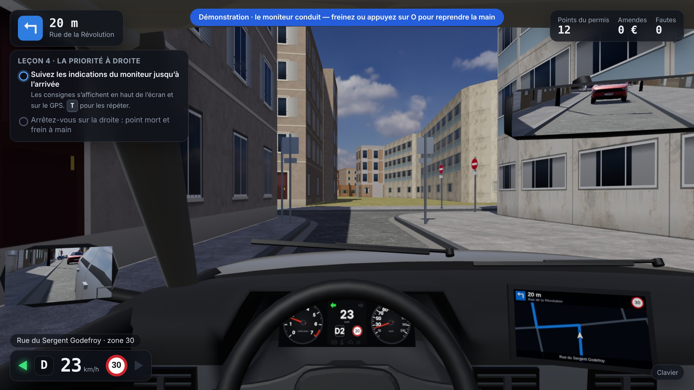

# Réalisme : ce qui a été mesuré

Ce document rassemble les vérifications chiffrées du simulateur. Tout ce qui suit est rejoué par
`npm test` (physique, volant, barème, pilote automatique) ou par les outils de `tools/essais/`.

## 1. La voiture face à une citadine réelle

Référence : Renault Clio V 1.0 TCe 100 (100 ch, 160 N·m, 1 178 kg à vide, 0 à 100 km/h en 11,8 s,
187 km/h), d'après les fiches techniques publiées par
[auto-data.net](https://www.auto-data.net/fr/renault-clio-v-phase-i-1.0-tce-100hp-36964) et
[zeperfs.com](https://zeperfs.com/en/fiche8078-renault-clio-v-1-0-tce.htm). Les valeurs « Jeu » sont
mesurées en faisant rouler le modèle physique (`tests/realisme.test.ts`, `tests/car.test.ts`).

| Grandeur | Jeu | Voiture réelle |
|---|---|---|
| Masse en ordre de marche | 1 255 kg (conducteur compris) | 1 178 kg à vide |
| Couple maximal | 160 N·m | 160 N·m |
| Puissance maximale | 74 kW (100 ch) | 74 kW (100 ch) |
| Empattement / longueur | 2,58 m / 4,05 m | 2,58 m / 4,05 m |
| 0 à 100 km/h | 11,7 s | 11,8 s |
| Vitesse maximale | 187 km/h | 187 km/h |
| Freinage 50 → 0 km/h | 11,1 m (0,89 g) | ≈ 10 m (1 g, pneus été sur sec) |
| Freinage 100 → 0 km/h | 41,0 m (0,96 g) | 36 à 40 m (ordre de grandeur des essais de presse, non sourcé ici) |
| Diamètre de braquage entre trottoirs | 10,4 m | non retrouvé dans les fiches consultées |
| Accélération latérale maximale | 0,92 g, sous-vireur à la limite | — |

Comportements vérifiés par test : ralenti tenu, **calage** si l'embrayage est relâché d'un coup en
première sans gaz, démarrage au point de patinage sans accélérer, rapport refusé sans débrayer,
rampage en boîte automatique, immobilité parfaite à l'arrêt, rappel du volant vers le centre.

## 2. Le volant Logitech G923

Aucun volant n'était branché à la machine de développement. La chaîne complète est donc vérifiée
avec un **G923 émulé** (`tests/volant.test.ts`, 9 tests) :

- un faux périphérique *Gamepad* : reconnaissance du volant, direction 1:1 sur 900°, pédales
  (repos à +1, zone morte), palettes, levier en H, assistant de calibration quel que soit l'ordre des
  axes, profil mémorisé ;
- un faux périphérique *WebHID* qui enregistre les trames envoyées :
  - G923 PlayStation/PC (046d:c266) : `F5` (centrage coupé), `F8 81 84 03` (900°),
    `11 08 <niveau> 80` (effort constant, `80` = neutre), `13` (effort nul) — le format du pilote
    Linux `hid-lg4ff.c`, tel que je le connais (son code source n'a pas été relu pendant ce travail) ;
  - G923 Xbox/PC (046d:c26e) : HID++, recherche de la fonctionnalité `0x8123`, remise à zéro, gains,
    effet constant à démarrage automatique mis à jour à chaque image — la séquence du pilote Linux
    `hid-logitech-hidpp.c`, sous la même réserve.

Ce qui reste invérifiable sans matériel : le **sens** de l'effort (une case « Inverser » et un bouton
« Tester » sont prévus pour cela) et le ressenti.

## 3. Le Code de la route

Voir la section 7 de [`code-de-la-route-recherche.md`](code-de-la-route-recherche.md) : barème
recoupé le 20 novembre 2026 avec les fiches de service-public, figé par `tests/bareme.test.ts`
(32 tests).

## 4. Un élève qui conduit bien n'est pas sanctionné à tort

Un conducteur automatique respectueux du Code parcourt des itinéraires de leçon dans la
circulation, avec la vraie physique ; le moniteur ne doit rien lui reprocher de grave.

| Essai | Résultat |
|---|---|
| `npm test` : 5 leçons (feux, priorité, tournants, giratoire, grands axes) | 5 sur 5 sans faute grave ni accrochage |
| `tools/essais/balayage.test.ts`, 48 trajets (6 thèmes × 8 tirages) | 48 terminés ; 45 sans faute grave ni accrochage ; restent 2 accrochages à moins de 15 km/h et 1 contact de trottoir (rue Molière) |
| Circulation seule, 45 véhicules autour de la Croix de Chavaux pendant 6 min | arrêt le plus long 97 s, vitesse moyenne 14 km/h ; 33 chevauchements brefs entre voitures relevés dans ce très grand carrefour (défaut visuel connu) |

Ces essais ont fait corriger plusieurs **fausses fautes** : refus de priorité signalé à une voiture
arrêtée à sa ligne de stop, sens interdit dans une rue à sens unique tracée à l'envers, clignotant
exigé avant un carrefour impossible à anticiper, ligne de stop placée 11 m trop tôt.

## 5. Charge de rendu

Mesurée dans la version de production (`npm run build`), scène de boulevard avec circulation,
réglage de qualité par défaut :

| Mesure | Valeur |
|---|---|
| Simulation (physique à 1 kHz, circulation, règles) | 0,18 ms de processeur par image |
| Appels de dessin par image | ≈ 170 |
| Triangles par image | ≈ 1,3 million |
| Textures / géométries en mémoire | 38 / 215 |

Le nombre d'images par seconde n'a **pas** pu être mesuré : la machine de développement n'a pas de
carte graphique (rendu logiciel). À titre indicatif, 170 appels et 1,3 million de triangles sont une
charge modeste pour une carte graphique dédiée récente ; les réglages « Affichage » permettent de
réduire ombres, rétroviseurs et distance de vue.

## 6. Captures

