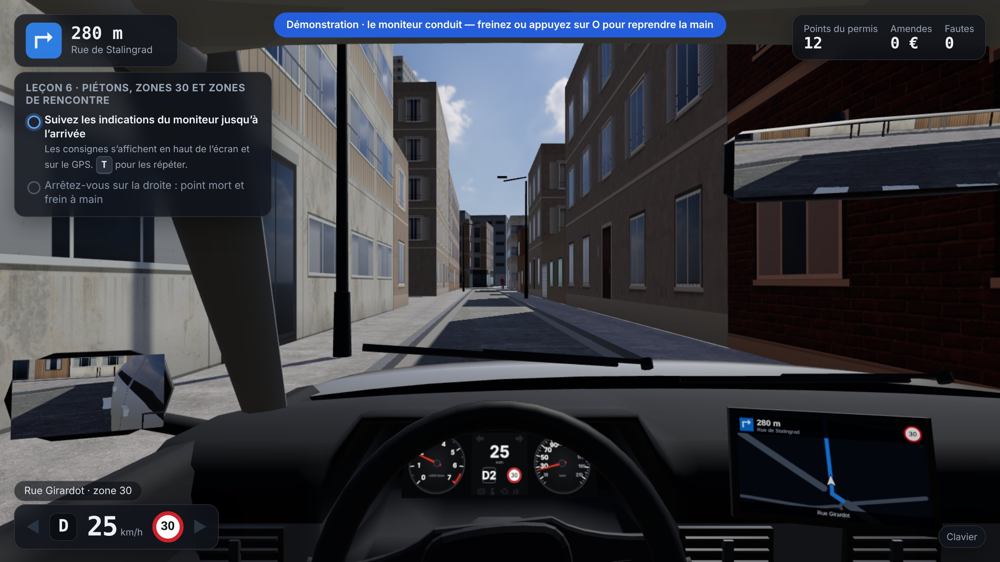

# Réalisme : ce qui a été mesuré

Ce document rassemble les vérifications chiffrées du simulateur. Tout ce qui suit est rejoué par
`npm test` (physique, volant, barème, pilote automatique) ou par les outils de `tools/essais/`.

## 1. La voiture face à une citadine réelle

Référence : Renault Clio V 1.0 TCe 100 (100 ch, 160 N·m, 1 178 kg à vide, 0 à 100 km/h en 11,8 s,
187 km/h), d'après les fiches techniques publiées par
[auto-data.net](https://www.auto-data.net/fr/renault-clio-v-phase-i-1.0-tce-100hp-36964) et
[zeperfs.com](https://zeperfs.com/en/fiche8078-renault-clio-v-1-0-tce.htm). Les valeurs « Jeu » sont
mesurées en faisant rouler le modèle physique (`tests/realisme.test.ts`, `tests/car.test.ts`).

| Grandeur | Jeu | Voiture réelle |
|---|---|---|
| Masse en ordre de marche | 1 255 kg (conducteur compris) | 1 178 kg à vide |
| Couple maximal | 160 N·m | 160 N·m |
| Puissance maximale | 74 kW (100 ch) | 74 kW (100 ch) |
| Empattement / longueur | 2,58 m / 4,05 m | 2,58 m / 4,05 m |
| 0 à 100 km/h | 11,7 s | 11,8 s |
| Vitesse maximale | 187 km/h | 187 km/h |
| Freinage 50 → 0 km/h | 11,1 m (0,89 g) | ≈ 10 m (1 g, pneus été sur sec) |
| Freinage 100 → 0 km/h | 41,0 m (0,96 g) | 36 à 40 m (ordre de grandeur des essais de presse, non sourcé ici) |
| Diamètre de braquage entre trottoirs | 10,4 m | non retrouvé dans les fiches consultées |
| Accélération latérale maximale | 0,92 g, sous-vireur à la limite | — |

Comportements vérifiés par test : ralenti tenu, **calage** si l'embrayage est relâché d'un coup en
première sans gaz, démarrage au point de patinage sans accélérer, rapport refusé sans débrayer,
rampage en boîte automatique, immobilité parfaite à l'arrêt, rappel du volant vers le centre.

## 2. Le volant Logitech G923

Aucun volant n'était branché à la machine de développement. La chaîne complète est donc vérifiée
avec un **G923 émulé** (`tests/volant.test.ts`, 10 tests) :

- un faux périphérique *Gamepad* : reconnaissance du volant, direction 1:1 sur 900°, pédales
  (repos à +1, zone morte), palettes, levier en H, assistant de calibration quel que soit l'ordre des
  axes, profil mémorisé ;
- un faux périphérique *WebHID* qui enregistre les trames envoyées. Le code source des pilotes Linux a
  été relu pour fixer les trames attendues :
  - **G923 PlayStation/PC** : le pilote officiel `hid-lg4ff.c` ne connaît pas ce volant ; c'est le
    pilote communautaire [new-lg4ff](https://github.com/berarma/new-lg4ff) qui le prend en charge
    (046d:c266 en mode natif, 046d:c267 en mode PlayStation). Le jeu envoie les mêmes commandes :
    `F5` (centrage coupé), `F8 81 84 03` (rotation 900°), `11 00 <niveau>` pour lancer l'effort
    constant, `1C 00 <niveau>` pour le rafraîchir, `13` pour l'arrêter (`80` = neutre). En mode
    PlayStation, il demande d'abord le passage en mode natif (rapport `30` : `F8 09 07 01 01`),
    après quoi le volant se reconnecte et doit être autorisé de nouveau ;
  - **G923 Xbox/PC** (046d:c26e) : protocole HID++ de `hid-logitech-hidpp.c` — fonctionnalité `0x8123`,
    remise à zéro (`11`), gains (`81`), effet constant à démarrage automatique téléchargé par la
    fonction `21`, force sur 16 bits aux octets 6 et 7 des paramètres.

**Sens de l'effort.** Aucun des deux pilotes n'écrit de quel côté de la valeur neutre le volant part
à droite, et le document de protocole du constructeur n'est plus en ligne (la copie archivée n'était
pas joignable depuis l'environnement de développement). Le sens se déduit toutefois de conventions
documentées, relues dans les sources le 20 novembre 2026 :

1. SDL (`SDL_haptic.h`) : une direction est « celle d'où vient la force, et non celle dans laquelle
   elle s'exerce » ; l'est vaut (1, 0) ;
2. SDL pour Linux (`SDL_syshaptic.c`) traduit l'est — et l'axe de direction d'un volant — par `0x4000` ;
3. le noyau (`ff-memless.c`) calcule `x = sin(direction) × niveau`, soit `+niveau` pour `0x4000` ;
4. `hid-lg4ff.c` envoie l'octet `x + 0x80` ; `hid-logitech-hidpp.c` envoie la force signée telle quelle.

Un niveau positif (octet supérieur à `80`, force HID++ positive) est donc une force venant de la
droite, qui pousse le volant vers la gauche ; pour pousser à droite, le jeu envoie un octet inférieur
à `80` ou une force HID++ négative. C'est son réglage par défaut pour les deux versions du G923.

**Ce qui reste invérifiable sans matériel** : que le volant suive bien cette convention (d'où le
bouton « Tester », qui demande de quel côté il est parti et inverse le sens s'il le faut),
l'acceptation par le navigateur du rapport `30` de changement de mode, et le ressenti.

## 3. Le Code de la route

Voir la section 7 de [`code-de-la-route-recherche.md`](code-de-la-route-recherche.md) : chaque
article du barème a été relu le 20 novembre 2026 dans le texte officiel (base LEGI publiée par la
DILA, script `tools/bareme/verifier-legi.py`) et les montants sur les fiches de service-public ;
aucune valeur n'a dû être corrigée. `tests/bareme.test.ts` fige le tout (32 tests).

## 4. Un élève qui conduit bien n'est pas sanctionné à tort

Un conducteur automatique respectueux du Code parcourt des itinéraires de leçon dans la
circulation, avec la vraie physique ; le moniteur ne doit rien lui reprocher de grave.

| Essai | Résultat |
|---|---|
| `npm test` : 5 leçons (feux, priorité, tournants, giratoire, grands axes) | 5 sur 5 sans faute grave ni accrochage |
| `npm run test:endurance` : 48 trajets (6 thèmes × 8 tirages), départ choisi comme dans le jeu | 48 sur 48 sans faute grave ni accrochage. Huit séries de 48 ont été parcourues (`BASE=101`, `500`, `900`, `1300`, `1700`, `2100`, `2500`, `2900`) : 384 trajets sur 384. Les trois premières ont servi à la mise au point ; les cinq autres n'ont été lancées qu'une fois, à la fin, sur des tirages jamais vus : 240 sur 240 |
| Circulation seule autour de la Croix de Chavaux pendant 6 min, 18 tirages, à la densité du jeu (28 véhicules) | 17 tirages sans aucun chevauchement de carrosseries entre véhicules, 1 tirage avec un seul chevauchement instantané ; immobilisation la plus longue : 72 s (un véhicule qui laisse passer un cycle de feu) |
| Même essai à densité forcée (45 véhicules) | 1 chevauchement instantané au total sur les 12 tirages ; immobilisation la plus longue : 44 s |
| `node tools/essais/navigateur.cjs` : six leçons guidées ouvertes par le menu dans la version compilée du jeu, démonstration du moniteur, 4 à 7 min simulées chacune | aucune erreur JavaScript, aucune faute, aucun choc, aucun chevauchement ; jusqu'à 30 véhicules et 8 réservations simultanées ; 1,1 à 1,9 km parcourus par leçon (4 arrivées, 2 encore en route à la fin du temps imparti) |

**Ce que ces chiffres ne disent pas.** Les trajets sont ceux d'un conducteur automatique, pas d'un
élève : ils garantissent qu'une conduite correcte n'est pas sanctionnée et que la circulation ne se
noue pas, non que tout comportement d'élève sera jugé comme le ferait un inspecteur. Jusqu'à cette
version, les essais partaient toujours de la première rue de départ de chaque thème alors que le jeu
en change selon le tirage : les aligner a révélé plusieurs défauts réels, corrigés ci-dessous.

Ces essais ont fait corriger plusieurs **fausses fautes** : refus de priorité signalé à une voiture
arrêtée à sa ligne de stop, sens interdit dans une rue à sens unique tracée à l'envers, clignotant
exigé avant un carrefour impossible à anticiper, ligne de stop placée 11 m trop tôt, ligne de feu
décalée de plusieurs mètres dans les rues courbes, autobus qui balayait la voie voisine en tournant,
voiture située par erreur sur la chaussée voisine à contresens dans une grande place (faux « sens
interdit », faux « départ du stationnement »).
Les itinéraires de leçon ne sont retenus que si chaque virage est praticable sans toucher une bordure,
un mur ou une façade ; à défaut, la leçon part de la rue du thème dont le parcours est le plus net.

Ils ont aussi fait corriger des **défauts de la circulation** : véhicule affiché en travers pendant
une image sur une liaison de longueur nulle (il pouvait pousser la voiture de l'élève sur le
trottoir), véhicules et cyclistes qui sous-estimaient l'encombrement d'une voiture de biais et en
frôlaient l'angle, piéton qui descendait du trottoir au passage d'une voiture en train de tourner,
véhicule entré dans une voie sans issue qui retenait toute la file derrière lui.

**Grandes places (Croix de Chavaux, porte de Bagnolet, porte de Montreuil).** Leurs carrefours sont
reliés par des voies de quelques mètres, où un véhicule ne tient pas sans déborder sur le carrefour
précédent. La circulation les traverse donc comme un seul carrefour : avant d'y entrer, chaque véhicule
réserve tout son trajet jusqu'à la sortie, ainsi que sa place à la sortie (R415-2 : on ne s'engage pas
si l'on risque de rester immobilisé). Deux trajets qui se croisent, se frôlent ou se rejoignent ne
sont jamais réservés en même temps ; entre deux entrées concurrentes, celui qui attend depuis le plus
longtemps passe d'abord, sauf priorité contraire. C'est ce qui a fait pratiquement disparaître les
chevauchements de carrosseries (jusqu'à 200 instants par essai sur certains tirages avant cette
version ; un seul instant sur 18 essais désormais).

**Égards envers l'élève.** Les autres véhicules le laissent s'insérer quand deux files se rejoignent
en une seule ou qu'il met son clignotant vers leur voie ; nez à nez au milieu d'un carrefour, le
véhicule recule de quelques mètres ; un cycliste attend quand la voiture va couper sa traversée.

Derniers garde-fous contre les embouteillages : entre usagers à l'arrêt qui se cèdent mutuellement le
passage, celui qui attend depuis le plus longtemps passe ; la circulation n'entre pas dans les voies
sans issue ; en dernier recours (30 s de blocage complet près du joueur, ou 75 s d'immobilisation à
plus de 45 m de lui), le véhicule est retiré de la circulation.

## 5. Charge de rendu

Mesurée dans la version de production (`npm run build`), scène de boulevard avec circulation,
réglage de qualité par défaut :

| Mesure | Valeur |
|---|---|
| Simulation (physique à 1 kHz, circulation, règles) | 0,18 ms de processeur par image |
| Appels de dessin par image | ≈ 170 |
| Triangles par image | ≈ 1,3 million |
| Textures / géométries en mémoire | 38 / 215 |

Le nombre d'images par seconde sur une carte graphique n'a **pas** pu être mesuré : la machine de
développement n'en a pas (rendu logiciel SwiftShader sur 4 cœurs, où le jeu tourne à 0,24 image par
seconde — chiffre sans rapport avec un vrai GPU). 170 appels et 1,3 million de triangles sont une
charge modeste pour une carte graphique dédiée récente.

Pour ne pas dépendre de cette mesure, le jeu **se règle lui-même** : un régulateur mesure la cadence
réelle et, si elle reste sous 40 images par seconde pendant 3 s, allège l'affichage d'un cran
(résolution, distance de vue, puis rétroviseurs en dernier recours) ; il rétablit un cran après 25 s
au-dessus de 57 images par seconde. Vérifié dans le navigateur : sur le rendu logiciel, il descend au
dernier cran et la cadence mesurée passe de 0,24 à 0,67 image par seconde. Il se désactive dans
*Réglages → Fluidité automatique* (ou avec `?perf=fixe` dans l'adresse).

Pour connaître la cadence sur votre machine : *Réglages → Mesurer la fluidité*. Le moniteur conduit
20 secondes sur un boulevard, puis le jeu affiche la cadence moyenne et minimale, le nom de la carte
graphique utilisée par le navigateur et un conseil de réglage (rapport copiable). Essayée ici de bout en
bout, la mesure identifie bien le rendu logiciel et le signale.

## 6. Captures

