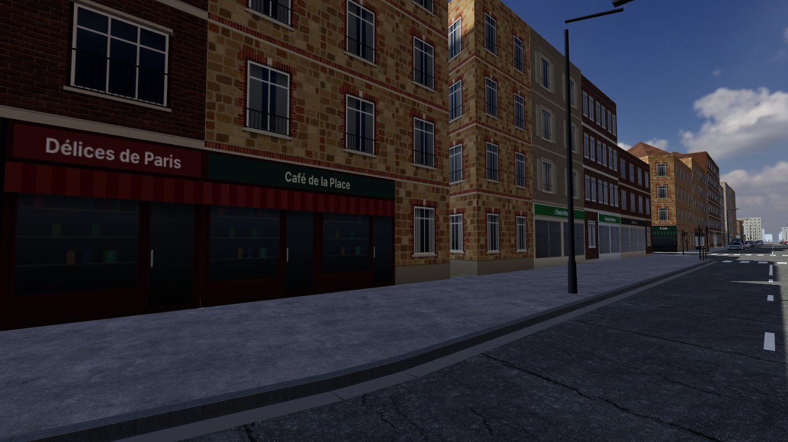
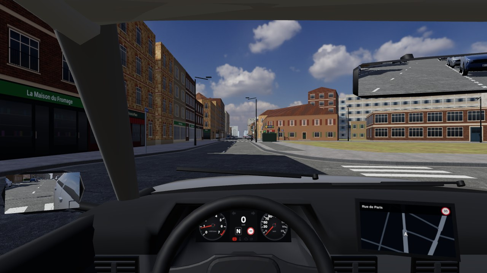
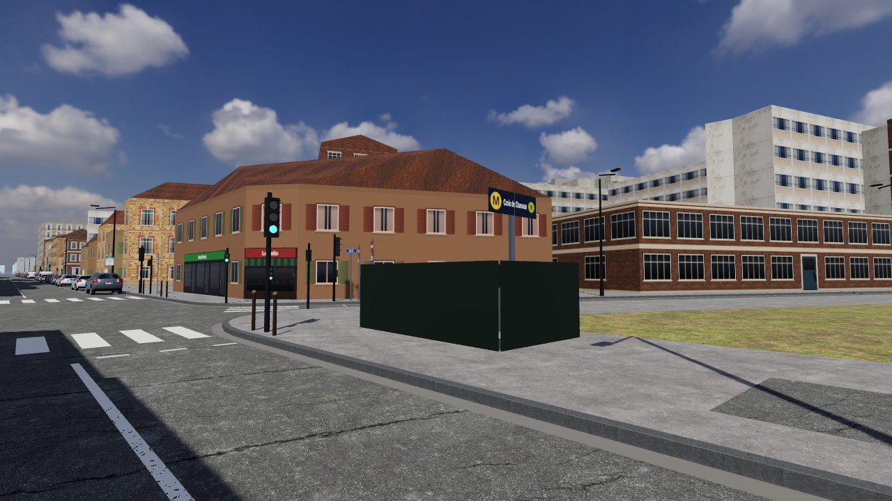
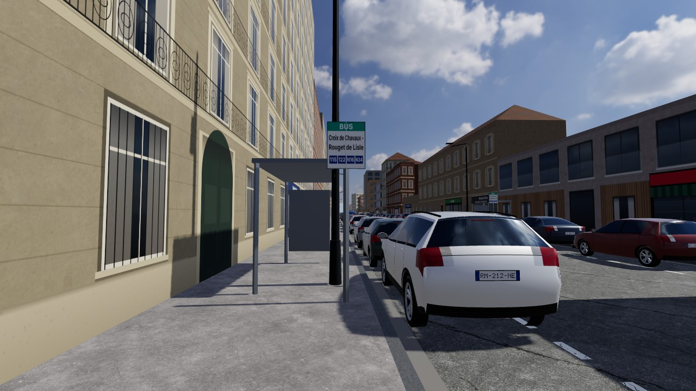
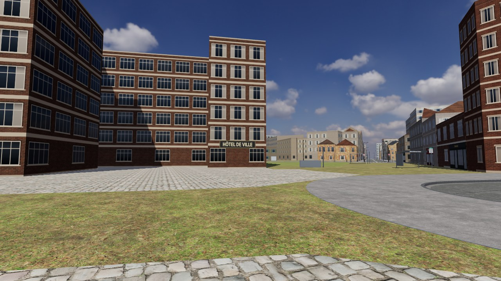
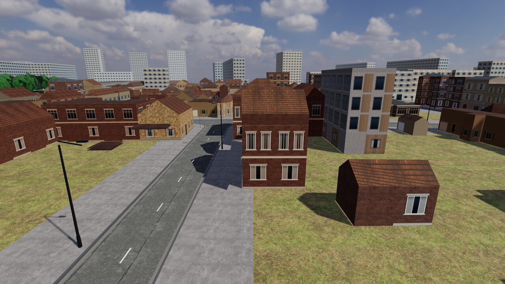
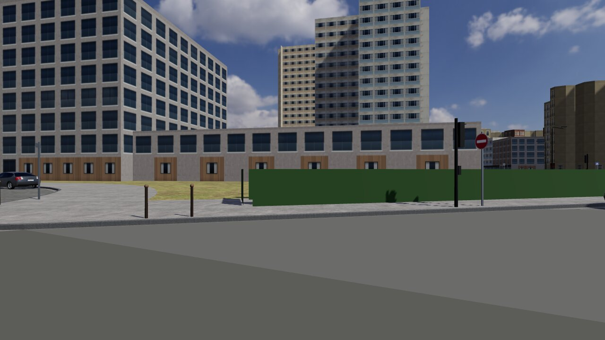
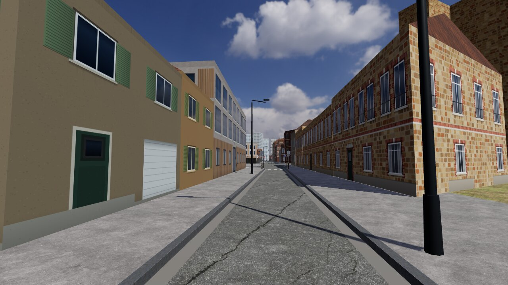
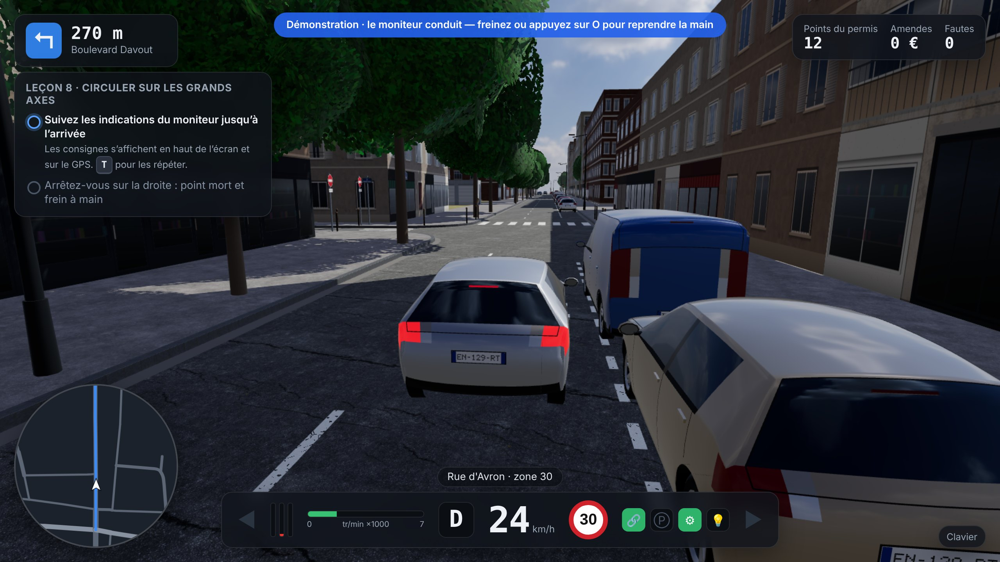

# Réalisme : ce qui a été mesuré

Ce document rassemble les vérifications chiffrées du simulateur. Tout ce qui suit est rejoué par
`npm test` (physique, volant, barème, pilote automatique) ou par les outils de `tools/essais/`.

## 1. La voiture face à une citadine réelle

Référence : Renault Clio V 1.0 TCe 100 (100 ch, 160 N·m, 1 178 kg à vide, 0 à 100 km/h en 11,8 s,
187 km/h), d'après les fiches techniques publiées par
[auto-data.net](https://www.auto-data.net/fr/renault-clio-v-phase-i-1.0-tce-100hp-36964) et
[zeperfs.com](https://zeperfs.com/en/fiche8078-renault-clio-v-1-0-tce.htm). Les valeurs « Jeu » sont
mesurées en faisant rouler le modèle physique (`tests/realisme.test.ts`, `tests/car.test.ts`).

| Grandeur | Jeu | Voiture réelle |
|---|---|---|
| Masse en ordre de marche | 1 255 kg (conducteur compris) | 1 178 kg à vide |
| Couple maximal | 160 N·m | 160 N·m |
| Puissance maximale | 74 kW (100 ch) | 74 kW (100 ch) |
| Empattement / longueur | 2,58 m / 4,05 m | 2,58 m / 4,05 m |
| 0 à 100 km/h | 11,7 s | 11,8 s |
| Vitesse maximale | 187 km/h | 187 km/h |
| Freinage 50 → 0 km/h | 11,1 m (0,89 g) | ≈ 10 m (1 g, pneus été sur sec) |
| Freinage 100 → 0 km/h | 41,0 m (0,96 g) | 36 à 40 m (ordre de grandeur des essais de presse, non sourcé ici) |
| Diamètre de braquage entre trottoirs | 10,4 m | non retrouvé dans les fiches consultées |
| Accélération latérale maximale | 0,92 g, sous-vireur à la limite | — |

Comportements vérifiés par test : ralenti tenu, **calage** si l'embrayage est relâché d'un coup en
première sans gaz, démarrage au point de patinage sans accélérer, rapport refusé sans débrayer,
rampage en boîte automatique, immobilité parfaite à l'arrêt, rappel du volant vers le centre.

## 2. Le volant Logitech G923

Aucun volant n'était branché à la machine de développement. La chaîne complète est donc vérifiée
avec un **G923 émulé** (`tests/volant.test.ts`, 16 tests) :

- un faux périphérique *Gamepad* : reconnaissance du volant, direction 1:1 sur 900°, pédales
  (repos à +1, zone morte), palettes, levier en H, assistant de calibration quel que soit l'ordre des
  axes, profil mémorisé ;
- un faux périphérique *WebHID* qui enregistre les trames envoyées. Le code source des pilotes Linux a
  été relu pour fixer les trames attendues :
  - **G923 PlayStation/PC** : le pilote officiel `hid-lg4ff.c` ne connaît pas ce volant ; c'est le
    pilote communautaire [new-lg4ff](https://github.com/berarma/new-lg4ff) qui le prend en charge
    (046d:c266 en mode natif, 046d:c267 en mode PlayStation). Le jeu envoie les mêmes commandes :
    `F5` (centrage coupé), `F8 81 84 03` (rotation 900°), `11 00 <niveau>` pour lancer l'effort
    constant, `1C 00 <niveau>` pour le rafraîchir, `13` pour l'arrêter (`80` = neutre). En mode
    PlayStation, il demande d'abord le passage en mode natif (rapport `30` : `F8 09 07 01 01`),
    après quoi le volant se reconnecte et doit être autorisé de nouveau ;
  - **G923 Xbox/PC** (046d:c26e) : protocole HID++ de `hid-logitech-hidpp.c` — fonctionnalité `0x8123`,
    remise à zéro (`11`), gains (`81`), effet constant à démarrage automatique téléchargé par la
    fonction `21`, force sur 16 bits aux octets 6 et 7 des paramètres.

**Sens de l'effort.** Aucun des deux pilotes n'écrit de quel côté de la valeur neutre le volant part
à droite, et le document de protocole du constructeur n'est plus en ligne (la copie archivée n'était
pas joignable depuis l'environnement de développement). Le sens se déduit toutefois de conventions
documentées, relues dans les sources le 20 novembre 2026 :

1. SDL (`SDL_haptic.h`) : une direction est « celle d'où vient la force, et non celle dans laquelle
   elle s'exerce » ; l'est vaut (1, 0) ;
2. SDL pour Linux (`SDL_syshaptic.c`) traduit l'est — et l'axe de direction d'un volant — par `0x4000` ;
3. le noyau (`ff-memless.c`) calcule `x = sin(direction) × niveau`, soit `+niveau` pour `0x4000` ;
4. `hid-lg4ff.c` envoie l'octet `x + 0x80` ; `hid-logitech-hidpp.c` envoie la force signée telle quelle.

Un niveau positif (octet supérieur à `80`, force HID++ positive) est donc une force venant de la
droite, qui pousse le volant vers la gauche ; pour pousser à droite, le jeu envoie un octet inférieur
à `80` ou une force HID++ négative. C'est son réglage par défaut pour les deux versions du G923.

**Le jeu vérifie lui-même sur votre volant.** Faute de pouvoir essayer un G923 ici, la vérification a
été confiée au jeu : le bouton « Vérifier » (*Volant et commandes*) envoie une poussée d'une demi-seconde
vers la droite tout en lisant la position du volant. S'il part à droite, le sens est confirmé ; s'il part
à gauche, le sens est inversé et une seconde poussée le confirme ; s'il ne bouge pas (volant tenu,
moteur non alimenté) ou si sa position est illisible, le jeu le dit et pose la question à l'utilisateur.
La date de la vérification est conservée et affichée. `tests/volant.test.ts` exerce ces cas avec un
volant factice qui tourne sous l'effet des trames reçues — dans le sens prévu, dans le sens contraire,
ou pas du tout — pour les deux protocoles (6 tests). `tools/essais/volant-navigateur.cjs` rejoue le
parcours complet dans le navigateur, sur la version compilée : réglages, connexion, bouton « Vérifier »,
avec un G923 simulé dans la page ; le jeu y annonce « parti de 93° vers la droite », ou, sur un volant
simulé au sens inversé, corrige le sens puis le reconfirme.

**Ce qui reste à constater sur le matériel** : le résultat de cette vérification sur un vrai G923,
l'acceptation par le navigateur du rapport `30` de changement de mode, et le ressenti.

## 3. Le Code de la route

Voir la section 7 de [`code-de-la-route-recherche.md`](code-de-la-route-recherche.md) : chaque
article du barème a été relu le 20 novembre 2026 dans le texte officiel (base LEGI publiée par la
DILA, script `tools/bareme/verifier-legi.py`) et les montants sur les fiches de service-public ;
aucune valeur n'a dû être corrigée. `tests/bareme.test.ts` fige le tout (32 tests).

## 4. Un élève qui conduit bien n'est pas sanctionné à tort

Un conducteur automatique respectueux du Code parcourt des itinéraires de leçon dans la
circulation, avec la vraie physique ; le moniteur ne doit rien lui reprocher de grave.

| Essai | Résultat |
|---|---|
| `npm test` : 5 leçons (feux, priorité, tournants, giratoire, grands axes) | 5 sur 5 sans faute grave ni accrochage |
| `npm run test:endurance` : 48 trajets (6 thèmes × 8 tirages), départ choisi comme dans le jeu | 48 sur 48 sans faute grave ni accrochage. Avec le code final, 21 séries de 48 ont été parcourues (`BASE=101`, `500`, `900`, puis de `1300` à `8100` par pas de 400) : **1008 trajets sur 1008** |
| Séries jamais vues, à leur premier passage (18 séries lancées au fil de la mise au point, chacune avant toute correction la concernant) | 858 trajets sur 864 (99,3 %). Les 6 échecs — deux feux franchis au rouge (redémarrage à l'orange depuis l'arrêt, même cause), un refus de priorité en dégageant un carrefour à l'orange, un refus de priorité relevé à tort par le moteur de règles, un accrochage à 6 km/h entre deux files dont les trajectoires se frôlent, un piéton touché à 3 km/h — ont chacun été diagnostiqués et corrigés ; les trois dernières séries neuves (144 trajets) sont passées sans échec |
| Circulation seule autour de la Croix de Chavaux pendant 6 min, 18 tirages, à la densité du jeu (28 véhicules) | 17 tirages sans aucun chevauchement de carrosseries entre véhicules, 1 tirage avec 6 chevauchements instantanés ; immobilisation la plus longue : 72 s (un véhicule qui laisse passer un cycle de feu) |
| Même essai à densité forcée (45 véhicules), 18 tirages | 17 tirages sans aucun chevauchement, 1 tirage avec un seul ; immobilisation la plus longue : 74 s |
| `node tools/essais/navigateur.cjs` : six leçons guidées ouvertes par le menu dans la version compilée du jeu, démonstration du moniteur, 4 à 7 min simulées chacune | aucune erreur JavaScript, aucune faute, aucun choc, aucun chevauchement ; jusqu'à 30 véhicules et 8 réservations simultanées ; 1,1 à 1,9 km parcourus par leçon (4 arrivées, 2 encore en route à la fin du temps imparti) |

**Ce que ces chiffres ne disent pas.** Les trajets sont ceux d'un conducteur automatique, pas d'un
élève : ils garantissent qu'une conduite correcte n'est pas sanctionnée et que la circulation ne se
noue pas, non que tout comportement d'élève sera jugé comme le ferait un inspecteur. Et le taux au
premier passage le montre : il reste des situations rares — de l'ordre d'un trajet sur cent cinquante
— que ces essais n'ont pas encore rencontrées. Jusqu'à cette
version, les essais partaient toujours de la première rue de départ de chaque thème alors que le jeu
en change selon le tirage : les aligner a révélé plusieurs défauts réels, corrigés ci-dessous.

Ces essais ont fait corriger plusieurs **fausses fautes** : refus de priorité signalé à une voiture
arrêtée à sa ligne de stop, sens interdit dans une rue à sens unique tracée à l'envers, clignotant
exigé avant un carrefour impossible à anticiper, ligne de stop placée 11 m trop tôt, ligne de feu
décalée de plusieurs mètres dans les rues courbes, autobus qui balayait la voie voisine en tournant,
voiture située par erreur sur la chaussée voisine à contresens dans une grande place (faux « sens
interdit », faux « départ du stationnement »).
Les itinéraires de leçon ne sont retenus que si chaque virage est praticable sans toucher une bordure,
un mur ou une façade ; à défaut, la leçon part de la rue du thème dont le parcours est le plus net.

Ils ont aussi fait corriger des **défauts de la circulation** : véhicule affiché en travers pendant
une image sur une liaison de longueur nulle (il pouvait pousser la voiture de l'élève sur le
trottoir), véhicules et cyclistes qui sous-estimaient l'encombrement d'une voiture de biais et en
frôlaient l'angle, piéton qui descendait du trottoir au passage d'une voiture en train de tourner,
véhicule entré dans une voie sans issue qui retenait toute la file derrière lui.

**Grandes places (Croix de Chavaux, porte de Bagnolet, porte de Montreuil).** Leurs carrefours sont
reliés par des voies de quelques mètres, où un véhicule ne tient pas sans déborder sur le carrefour
précédent. La circulation les traverse donc comme un seul carrefour : avant d'y entrer, chaque véhicule
réserve tout son trajet jusqu'à la sortie, ainsi que sa place à la sortie (R415-2 : on ne s'engage pas
si l'on risque de rester immobilisé). Deux trajets qui se croisent, se frôlent ou se rejoignent ne
sont jamais réservés en même temps ; entre deux entrées concurrentes, celui qui attend depuis le plus
longtemps passe d'abord, sauf priorité contraire. C'est ce qui a fait pratiquement disparaître les
chevauchements de carrosseries (jusqu'à 200 instants par essai sur certains tirages avant cette
version ; 6 instants sur l'ensemble de 18 essais désormais, tous dans le même).

**Égards envers l'élève.** Les autres véhicules le laissent s'insérer quand deux files se rejoignent
en une seule ou qu'il met son clignotant vers leur voie ; nez à nez au milieu d'un carrefour, le
véhicule recule de quelques mètres ; un cycliste attend quand la voiture va couper sa traversée.

Derniers garde-fous contre les embouteillages : entre usagers à l'arrêt qui se cèdent mutuellement le
passage, celui qui attend depuis le plus longtemps passe ; la circulation n'entre pas dans les voies
sans issue ; en dernier recours (30 s de blocage complet près du joueur, ou 75 s d'immobilisation à
plus de 45 m de lui), le véhicule est retiré de la circulation.

## 5. Fluidité et charge de rendu

### Mesure sur une carte graphique réelle

La machine de développement n'a pas de carte graphique (rendu logiciel, 0,24 image par seconde : chiffre
sans rapport avec un vrai GPU). La cadence a donc été mesurée sur une machine qui en a une, louée à la
demande : un Mac Apple Silicon hébergé par GitHub (`.github/workflows/fluidite.yml`, script
`tools/essais/fluidite.cjs`). Le script ouvre la version compilée du jeu dans Chromium, lance la mesure
intégrée (*Réglages → Mesurer la fluidité* : le moniteur conduit une vingtaine de secondes sur un
boulevard, rétroviseurs actifs) et relève le rapport du jeu ainsi que la durée de chaque image.

Machine : `Apple M1 (Virtual)`, 3 cœurs ; carte annoncée par WebGL : `ANGLE (Apple, ANGLE Metal Renderer:
Apple Paravirtual device)` — un M1 **virtualisé**, à accélération matérielle Metal, nettement en deçà d'un
M1 non virtualisé ou d'une carte graphique de jeu. Mesure du 20 novembre 2026 (exécution n° 3 : le
moniteur parcourt 90 à 100 m à 20-27 km/h pendant le relevé) :

| Réglage | Cadence moyenne (minimum) | Durée médiane d'une image | 95 % des images sous |
|---|---|---|---|
| 1920 × 1080, qualité moyenne (réglage par défaut), synchronisation verticale | 41 images/s (28) | 17,5 ms | 35 ms |
| 1920 × 1080, qualité haute, synchronisation verticale | 24 images/s (11) | 33,5 ms | 83 ms |
| 1920 × 1080, qualité haute, cadence libre (sans synchronisation) | 41 images/s (24) | 21,2 ms | 48 ms |
| 2560 × 1440, qualité haute, cadence libre | 40 images/s (32) | 22,8 ms | 53 ms |

Charge relevée pendant ces essais : 370 à 530 appels de dessin et 1,3 à 2,5 millions de triangles par
image (rétroviseurs compris), 9 à 20 véhicules et 18 à 24 piétons autour de la voiture.

Lecture, sans l'enjoliver : sur ce GPU virtualisé modeste, le réglage par défaut (qualité moyenne, 1080p)
tourne autour de 40 images par seconde en conduite — jouable, pas parfaitement fluide. La qualité haute y
est trop lourde : une image prend 21 ms, donc la synchronisation verticale la fait retomber à 30 puis
20 images par seconde ; c'est le cas que le régulateur automatique (ci-dessous) corrige en allégeant
l'affichage. La cadence presque identique en 1440p et en 1080p montre que la limite est côté processeur
et pilote graphique (nombre d'objets), pas côté remplissage. Les deux premières exécutions, où la voiture
restait à l'arrêt (défaut du lancement de la mesure, corrigé), donnaient 44 à 47 images/s en qualité
moyenne et 41 à 63 en qualité haute sans synchronisation : d'une machine virtuelle à l'autre, les chiffres
varient d'un tiers. **Ce que cette mesure ne dit pas** : la cadence sur *votre* machine, que seule la
mesure intégrée au jeu peut donner ; une carte graphique de jeu devrait faire nettement mieux, mais ce
n'est pas mesuré.

Démarrage : le tout premier lancement sur une machine montrait un **gel de 6,8 s** au début de la leçon,
les programmes de rendu (shaders) se compilant à la première image où chaque matériau apparaissait. Ils
sont désormais compilés pendant l'écran de chargement, rétroviseurs compris (`Game.warmUp`) : le
chargement initial passe à 14-17 s la toute première fois (4 à 5 s ensuite) et le gel au début de la
première leçon à 3,1 s, puis 1,1 à 1,4 s aux lancements suivants — le temps de construire le quartier
de la leçon.

### Le jeu se règle lui-même

Un régulateur mesure la cadence réelle et, si elle reste sous 40 images par seconde pendant 3 s, allège
l'affichage d'un cran (résolution, distance de vue, puis rétroviseurs en dernier recours) ; il rétablit
un cran après 25 s au-dessus de 57 images par seconde. Vérifié dans le navigateur : sur le rendu
logiciel, il descend au dernier cran et la cadence mesurée passe de 0,24 à 0,67 image par seconde. Il se
désactive dans *Réglages → Fluidité automatique* (ou avec `?perf=fixe` dans l'adresse).

Pour connaître la cadence sur votre machine : *Réglages → Mesurer la fluidité*. Le moniteur conduit
20 secondes sur un boulevard, puis le jeu affiche la cadence moyenne et minimale, le nom de la carte
graphique utilisée par le navigateur et un conseil de réglage (rapport copiable).

La simulation elle-même (physique à 1 kHz, circulation, règles) coûte 0,18 ms de processeur par image.

## 6. Le décor : ce qui est réel, ce qui est dessiné

Le jeu ne contient aucun modèle 3D ni aucune photo de façade d'un immeuble réel. Il assemble des
données ouvertes, puis dessine le reste. Une seule photo y entre : la photo aérienne de l'IGN, qui
teinte le sol hors chaussée et les toits et dit où sont les jardins et les arbres.

| Élément | Source | Ce qui est réel | Ce qui est dessiné par le programme |
|---|---|---|---|
| Rues, carrefours, feux, passages | OpenStreetMap | tracé, sens, limitations, régimes de priorité, noms | profil en travers (largeur des voies, stationnement) déduit des balises quand il n'est pas saisi |
| Emprise des bâtiments | OpenStreetMap | le contour au sol de 12 266 bâtiments | — |
| Hauteur | IGN – BD TOPO, sinon OpenStreetMap | 71,6 % des bâtiments (72,9 % de la surface bâtie) mesurés par l'IGN, à l'égout du toit ; 8,4 % balisés dans OpenStreetMap | 20,0 % estimés d'après la surface, dont les annexes de moins de 60 m² noyées dans un bâtiment IGN cinq fois plus grand (sa hauteur n'est pas la leur) |
| Murs et toit | IGN – BD TOPO (fichiers fonciers) | matériau des murs pour 44,5 % des bâtiments, du toit pour 44,6 %, décennie de construction pour 54,8 % | pour les autres, matériau repris du voisin de même gabarit à moins de 20 m, sinon tiré au sort |
| Façades | — | — | **tout le dessin** : fenêtres, portes, balcons, vitrines, choisis parmi douze styles selon le matériau, l'époque, l'usage et le gabarit (la meulière apparente est réservée aux bâtiments de trois niveaux au plus) |
| Forme du toit | — | — | deux pans ou croupes sur les emprises simples (l'emprise doit remplir 88 % de son enveloppe convexe ; le débord est fermé par une sous-face), comble unique sur les églises, terrasse ailleurs |
| Commerces | OpenStreetMap | nom, type et position de 982 commerces et pharmacies | couleur du bandeau (par métier, ou par chaîne pour une vingtaine d'enseignes), vitrine, largeur de la devanture |
| Métro, bus | OpenStreetMap | position des 30 bouches et des 140 arrêts, nom de la station, ligne, lignes de bus, présence d'un abri | orientation (d'après la rue la plus proche), forme du totem, de l'abri et de l'escalier |
| Édifices nommés | OpenStreetMap | nom de 131 bâtiments (Hôtel de Ville, églises, théâtre, tours, résidences) | la plaque et son emplacement ; un clocher générique sur les églises et chapelles, un beffroi générique sur l'hôtel de ville ; aucun modèle propre |
| Plaques de rue | OpenStreetMap | nom de la rue | modèle de plaque (émail parisien à cartouche d'arrondissement dans le 20ᵉ, plaque bleue simple à Montreuil) |
| Places, parcs, terrains, parkings, massifs | OpenStreetMap | contour de 593 espaces et revêtement quand il est saisi (pavés, béton, enrobé, gazon, sol souple) | la matière ; les arbustes semés sur les massifs |
| Jardins et cours des cœurs d'îlot | IGN – BD ORTHO | où le sol est vert : part de végétation relevée sur la photo par cases de 4 m (104 ha de jardins, 268 ha de cours, bâti compris) | la limite, simplifiée à 3 m près ; la bande à moins de 6 m de la chaussée reste du trottoir, sauf devant un jardin |
| Arbres | OpenStreetMap, IGN – BD ORTHO | position de 2 824 arbres d'alignement (OpenStreetMap) ; position et largeur de houppier de 5 407 arbres relevés sur la photo | espèce des arbres de la photo, hauteur (déduite du houppier), forme ; leur nombre, plafonné à 10 par dalle de 100 m (16 439 houppiers relevés) |
| Clôtures des pavillons, jardins de devant | — | — | **tout** : 1 568 parcelles sur rue (12 km de murets, 7 km de haies, un portail par parcelle), posées à 3 m de la bordure là où la photo montre un jardin |
| Couleur du sol et des toits | IGN – BD ORTHO | couleur moyenne du toit de chaque bâtiment ; couleur des jardins, parcs et pelouses (photo à 50 cm) ; teinte moyenne sur 8 m des cours et places en béton | le relief (herbe, béton), les pavés des places, toute la chaussée et les trottoirs |

### Le sol, les arbres et la photo aérienne

La photo est la BD ORTHO de l'IGN, prise le 27 août 2024, téléchargée à 20 cm et livrée à 50 cm
(40 dalles de 400 m, 1,9 Mo). Elle sert à trois choses.

**Dire où sont les jardins et les arbres** (`tools/prepare-ortho.py`, puis `tools/build-map.mjs`).
Un pixel est de la végétation quand il est vert ; c'est un houppier quand il est en plus sombre et de
texture marquée (une pelouse est claire et lisse). Sur la carte livrée : 22,2 % du sol non bâti est de la
végétation, 13,3 % des houppiers ; 16 439 houppiers sont relevés hors des arbres déjà cartographiés,
dont 5 407 sont plantés (10 au plus par dalle de 100 m, les plus larges et les plus proches d'une rue
d'abord ; 70 écartés parce qu'ils tombent sur la chaussée ou à moins de 1,5 m, 394 sur un terrain de
sport ou un bassin). La Croix de Chavaux, qui n'avait que 2 arbres à 110 m à la ronde, en a 24.
Les seuils de couleur sont réglés à l'œil sur trois secteurs (Croix de Chavaux, parc des Guilands,
un quartier de pavillons) ; **le taux d'erreur n'est pas mesuré** : une friche à hautes herbes peut
recevoir des arbres, un arbre à l'ombre d'un immeuble peut manquer.

**Fermer les rues de pavillons.** Devant un jardin, la carte pose une clôture à 3 m de la bordure et un
jardin de devant derrière elle ; avant cela, la maison était posée sur 6 m de trottoir nu. Rien de cela
n'est relevé : la place de la clôture, son genre (muret, haie, les deux) et la largeur des parcelles
(9 à 17 m) sont tirés au sort, de façon reproductible. Les clôtures qui traverseraient un bâtiment à
l'alignement sont écartées (294 parcelles). Les 1 193 murs et clôtures relevés dans OpenStreetMap ne
changent pas.

**Teinter le sol et les toits** (`src/world/ortho.ts`). La photo n'est pas posée telle quelle :

- jardins, parcs, pelouses : la photo, nette au-delà de 28 m, réduite à une teinte moyenne sur 4 m à
  moins de 5 m (à 50 cm par pixel, de près, elle n'est qu'une bouillie) ; ce qui y est clair et gris
  (allée, béton, voiture) est écarté et laisse l'herbe procédurale ;
- cours, parkings, places en béton, aires de jeux : seulement sa teinte moyenne sur 8 m, pour 60 % au
  plus. Nette, elle y plaquait des voitures, des ombres et des houppiers aplatis ;
- places pavées, chaussée, trottoirs : pas de photo ;
- toits : la couleur moyenne relevée sur l'emprise du bâtiment, pas la photo.

La photo est calée sur les bâtiments à moins d'un mètre (mesure de l'auteur de l'outil sur 8
carrefours, par corrélation des contours : écart moyen 0,1 m, pire cas 0,9 m ; non refaite ici). La
chaussée du jeu, elle, vient d'OpenStreetMap et peut s'écarter de celle de la photo : de 3 à 5 m à la
Croix de Chavaux (estimation sur capture), réaménagée depuis la prise de vue. C'est pour cela que les
places qui bordent la route ne reçoivent plus la photo nette.

Coût, mesuré avec `tools/essais/budget.cjs` (Chromium sans carte graphique, 640 × 360, qualité
moyenne, somme des 6 images du cycle d'ombres, décor seul) entre la version d'avant ces ajouts et la
version livrée :

| Point de vue | Appels de dessin | Triangles |
|---|---|---|
| Croix de Chavaux, au sol | 3 059 → 3 168 (+3,6 %) | 17 028 k → 17 268 k (+1,4 %) |
| Croix de Chavaux, de 80 m | 2 542 → 2 667 (+4,9 %) | 12 661 k → 12 947 k (+2,3 %) |
| Église Saint-Pierre-Saint-Paul, de 60 m | 2 109 → 2 263 (+7,3 %) | 9 089 k → 9 367 k (+3,1 %) |
| Mairie, au sol | 2 554 → 2 662 (+4,2 %) | 9 626 k → 9 993 k (+3,8 %) |
| Parc des Guilands, au sol | 1 594 → 1 607 (+0,8 %) | 4 596 k → 4 929 k (+7,2 %) |
| Quartier de pavillons, au sol | 2 776 → 2 854 (+2,8 %) | 14 878 k → 15 217 k (+2,3 %) |

Les troncs sont versés dans un lot déjà dessiné et les houppiers regroupés par blocs de 2 × 2 dalles :
sans cela, les arbres de la photo ajoutaient un appel de dessin par dalle (+10,1 % devant l'église).
La photo ajoute une lecture de texture par fragment de sol et 7 à 9 textures de 800 × 800 px (24 à
31 Mo de mémoire graphique en qualité moyenne, calculé) ; la carte passe de 3,61 à 4,43 Mo (1,07 à
1,30 Mo compressée). **Non mesuré** : la cadence d'images sur une vraie carte graphique avec ces
ajouts.

Limites : un bois n'a que dix arbres par dalle de 100 m ; les arbres de la photo n'ont pas d'espèce ;
les ombres de la prise de vue sont atténuées, pas supprimées, et le relief du sol reste celui du
matériau choisi par la carte (herbe sur la piste d'athlétisme des Guilands, dont OpenStreetMap trace
en plus le chemin de ceinture quelques mètres à côté de la piste photographiée).

### Les enseignes

Chaque commerce d'OpenStreetMap est un point, souvent posé au milieu de la boutique. À la
construction de la carte (`tools/lib/enseignes.mjs`), il est rattaché au mur sur rue le plus proche
de son bâtiment — jamais à un mur mitoyen ni à un auvent ; à défaut de rue devant (passage, dalle),
au mur libre à moins de 6 m. Les commerces d'un même mur se le partagent. Résultat sur la carte
livrée :

- 938 commerces sur 982 rattachés à une façade (44 sans mur à proximité : kiosques, marchés, cœurs
  de centre commercial) ;
- 881 bandeaux à leur vrai nom ; 57 commerces sans nom et 11 locaux vacants ont une vitrine (rideau
  baissé pour les vacants) mais pas de bandeau ;
- les 30 bouches de métro portent le nom de leur station, lu dans la relation `stop_area`
  d'OpenStreetMap (le « nom » d'une bouche y est celui de la sortie), et leur ligne (3 ou 9) ; 24
  ont la place pour leur escalier ;
- 138 arrêts de bus nommés, dont 92 avec leur abri (10 abris cartographiés ne tiennent pas sur le
  trottoir du jeu).

Les noms sont écrits tels qu'ils sont saisis, accents compris ; un nom de plus de 26 caractères est
coupé à sa première précision ou au dernier mot entier. Aucun logo n'est reproduit.

Limites : les noms datent du téléchargement d'OpenStreetMap ; une vitrine sans commerce cartographié
peut encore apparaître sur les grands axes (tirage rare, sans nom) ; un commerce saisi dans le
mauvais bâtiment a son bandeau sur ce bâtiment.

### Ce que cela coûte à l'affichage

Tous les textes (1 124 cellules) tiennent dans un seul atlas de 4096 × 2176 px, dessiné une fois au
chargement, et dans un seul lot de géométrie par dalle de 100 m (317 dalles sur 640 en ont un ;
2 552 rectangles sur toute la carte). Mesure sur le jeu compilé, Chromium sans carte graphique,
1280 × 720, qualité moyenne, moyenne sur le cycle de 6 images des ombres (`tools/essais/budget.cjs`) ;
« avant » = sans enseignes ni arrêts :

| Point de vue | Appels de dessin | Triangles | Textures |
|---|---|---|---|
| Croix de Chavaux, décor seul | 457,5 → 465,8 (+1,8 %) | 2 632,0 k → 2 632,7 k | 36 → 37 |
| Rue de Paris (Croix de Chavaux), décor seul | 466,8 → 479,0 (+2,6 %) | 1 408,7 k → 1 409,0 k | 39 → 40 |
| Rue de Paris (Bas-Montreuil), décor seul | 443,5 → 455,5 (+2,7 %) | 2 351,8 k → 2 352,5 k | 36 → 37 |
| Croix de Chavaux, en conduite | 604,5 → 626,0 (+3,6 %) | 2 408 k → 2 410 k | 41 → 42 |
| Rue de Paris, en conduite | 647,0 → 660,8 (+2,1 %) | 2 321 k → 2 287 k | 41 → 42 |

Les points en conduite incluent la circulation, qui varie d'une exécution à l'autre (d'où des
triangles en baisse rue de Paris). Le nombre de programmes de rendu est inchangé (48, 49 en
conduite). L'atlas occupe environ 36 Mo de mémoire graphique, 48 Mo avec ses niveaux de détail
(calculé, non mesuré). **Non mesuré** : la cadence d'images sur une vraie carte graphique après ces
ajouts ; la mesure de la section 5 date d'avant.

### Licences des données

- Rues, emprises, noms des commerces, des arrêts et des stations : © les contributeurs
  d'OpenStreetMap, licence ODbL.
- Hauteurs, étages, matériaux et dates des bâtiments : IGN – BD TOPO, Licence Ouverte Etalab 2.0.
- Photographies aériennes (teinte du sol et des toits, relevé des jardins et des arbres) : IGN – BD
  ORTHO, prise de vue du 27 août 2024, Licence Ouverte Etalab 2.0.

Les trois mentions figurent dans la carte (`attribution`), dans le menu du jeu et dans le README.

## 7. Captures

